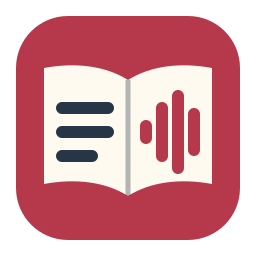

<p align="center">
  
</p>

# Cambridge Dictionary Audio

[](https://github.com/0then0/cambridge-dictionary-audio/actions/workflows/checks.yml)
[](https://github.com/0then0/cambridge-dictionary-audio/actions/workflows/mobile.yml)
[](https://github.com/0then0/cambridge-dictionary-audio/releases/latest)
[](https://pypi.org/project/cambridge-dictionary-audio/)
[](CONTRIBUTING.md#python-setup)
[](LICENSE)

[Русский](README.ru.md) · [Documentation](docs/README.md) · [Contributing](CONTRIBUTING.md) · [Changelog](CHANGELOG.md)

Save English pronunciations from [Cambridge Dictionary](https://dictionary.cambridge.org/)
as MP3 files and turn them into study material. Search a word, choose the meaning
you need, listen to the US or UK recording and keep it in a local collection with
its IPA, definition and an optional Russian translation. Export the collection to
Anki as a ready-made deck.

The project includes a desktop app for Windows, macOS and Linux, a command-line
tool with a terminal interface, Android and iOS apps, and a browser extension for
Chrome and Firefox.

## Features

- US and UK recordings with IPA transcriptions and English definitions.
- Explicit choice between meanings and pronunciations; each meaning is a separate
  collection entry, while meanings with the same recording share one MP3.
- Adding many words at once from a pasted list in the desktop app.
- Optional Russian translations from Cambridge or the offline
  [WikDict](https://www.wikdict.com/) dictionary, with personal edits.
- Anki export to `.apkg` with stable note identities, so re-exports update
  existing cards instead of duplicating them.
- Synthesis of phrases without their own recording from the recordings of
  individual words (uses FFmpeg).
- `.cda` backups that move a collection between the desktop and mobile apps.
- Interface in English, Russian, Spanish, German, French, Japanese and
  Brazilian Portuguese.

## Download

<!-- downloads:start -->
Direct downloads for the latest verified stable release **v1.0.1**:

| Platform | Architecture | Download |
| --- | --- | --- |
| Windows 10+ | x86-64 | [](https://github.com/0then0/cambridge-dictionary-audio/releases/download/v1.0.1/cambridge-dictionary-audio-1.0.1-windows-x86_64-setup.exe) [](https://github.com/0then0/cambridge-dictionary-audio/releases/download/v1.0.1/cambridge-dictionary-audio-1.0.1-windows-x86_64-portable.zip) |
| macOS 14+ | Apple Silicon (arm64) | [](https://github.com/0then0/cambridge-dictionary-audio/releases/download/v1.0.1/cambridge-dictionary-audio-1.0.1-macos-arm64.pkg) [](https://github.com/0then0/cambridge-dictionary-audio/releases/download/v1.0.1/cambridge-dictionary-audio-1.0.1-macos-arm64.dmg) [](https://github.com/0then0/cambridge-dictionary-audio/releases/download/v1.0.1/cambridge-dictionary-audio-1.0.1-macos-arm64.tar.gz) |
| macOS 14+ | Intel (x86-64) | [](https://github.com/0then0/cambridge-dictionary-audio/releases/download/v1.0.1/cambridge-dictionary-audio-1.0.1-macos-x86_64.pkg) [](https://github.com/0then0/cambridge-dictionary-audio/releases/download/v1.0.1/cambridge-dictionary-audio-1.0.1-macos-x86_64.dmg) [](https://github.com/0then0/cambridge-dictionary-audio/releases/download/v1.0.1/cambridge-dictionary-audio-1.0.1-macos-x86_64.tar.gz) |
| Linux | x86-64 · glibc 2.34+ | [](https://github.com/0then0/cambridge-dictionary-audio/releases/download/v1.0.1/cambridge-dictionary-audio_1.0.1_amd64.deb) [](https://github.com/0then0/cambridge-dictionary-audio/releases/download/v1.0.1/cambridge-dictionary-audio-1.0.1-1.x86_64.rpm) [](https://github.com/0then0/cambridge-dictionary-audio/releases/download/v1.0.1/cambridge-dictionary-audio-1.0.1-linux-x86_64-portable.tar.gz) |
| Android 9+ | arm64-v8a / armeabi-v7a / x86_64 | [](https://github.com/0then0/cambridge-dictionary-audio/releases/download/v1.0.1/cambridge-audio-1.0.1-android-debug-TEST-ONLY.apk) [](https://github.com/0then0/cambridge-dictionary-audio/releases/download/v1.0.1/cambridge-audio-1.0.1-android-unsigned-NOT-INSTALLABLE.apk) |
| iOS 17+ | arm64 | [](https://github.com/0then0/cambridge-dictionary-audio/releases/download/v1.0.1/cambridge-audio-1.0.1-ios-device-unsigned-REQUIRES-SIGNING.tar.gz) [](https://github.com/0then0/cambridge-dictionary-audio/releases/download/v1.0.1/cambridge-audio-1.0.1-ios-simulator-NOT-FOR-DEVICE.tar.gz) |
| Python CLI | Any | [](https://github.com/0then0/cambridge-dictionary-audio/releases/download/v1.0.1/cambridge_dictionary_audio-1.0.1-py3-none-any.whl) [](https://github.com/0then0/cambridge-dictionary-audio/releases/download/v1.0.1/cambridge_dictionary_audio-1.0.1.tar.gz) |
| Chrome | Any | [](https://github.com/0then0/cambridge-dictionary-audio/releases/download/v1.0.1/cambridge-audio-chrome-1.0.1.zip) |
| Firefox | Any | [](https://github.com/0then0/cambridge-dictionary-audio/releases/download/v1.0.1/cambridge-audio-firefox-1.0.1.zip) |

[](https://github.com/0then0/cambridge-dictionary-audio/releases/download/v1.0.1/SHA256SUMS.txt)

Android: the test APK uses a development certificate; the unsigned APK requires signing before installation. iOS: the device archive requires signing and a provisioning profile; the simulator build cannot be installed on an iPhone. [Installation and signing](docs/mobile/install.md).
<!-- downloads:end -->

Desktop installers and portable builds include Python, Qt and an audio-only
FFmpeg with LAME; nothing else needs to be installed. Windows builds require
Windows 10 or later. Installers are not signed with a publisher certificate and
macOS builds are not notarized, so the operating system may ask for confirmation
on first launch. Each release also contains the FFmpeg/LAME source archives and
`SHA256SUMS.txt`.

The command-line tool is published on [PyPI](https://pypi.org/project/cambridge-dictionary-audio/):

```sh
uv tool install cambridge-dictionary-audio
```

`pipx install cambridge-dictionary-audio` works as well.

## Quick start

**Desktop app.** Type a word or phrase and press **Find**. Choose a meaning,
switch between US and UK, listen with **Play** and press **Save meaning**.
Recordings are saved to `Cambridge Dictionary Audio` in your Downloads folder.
**Word list...** adds up to 100 words at once. See the [desktop guide](docs/desktop.md).

**Command line.**

```sh
cambridge-audio hello                          # saves downloads/hello.us.mp3
cambridge-audio "good morning" --accent both   # US and UK recordings
cambridge-audio hello --translation russian    # with a Russian translation
cambridge-audio                                # opens the terminal interface
```

See the [command-line guide](docs/cli.md) for all options and keyboard shortcuts.

**Mobile apps and browser extension.** See [Android and iOS](docs/mobile/README.md)
and the [browser extension guide](extension/README.md).

## Documentation

- [Desktop app](docs/desktop.md)
- [Command line and terminal interface](docs/cli.md)
- [Collection, translations and Anki](docs/collection.md)
- [Android and iOS](docs/mobile/README.md)
- [Browser extension](extension/README.md)
- [Data sources and licenses](docs/data-sources.md)
- [All documentation](docs/README.md)

## Run from source

Install [uv](https://docs.astral.sh/uv/getting-started/installation/) 0.13.0 or
newer, then run in the project directory:

```sh
uv sync --locked --group gui
uv run --locked --group gui -m cambridge_audio.gui   # desktop app
uv run --locked -m cambridge_audio hello             # command line
```

[CONTRIBUTING.md](CONTRIBUTING.md) explains the project structure, tests and
release builds. Bug reports and feature requests are welcome in
[GitHub issues](https://github.com/0then0/cambridge-dictionary-audio/issues/new/choose);
please report security problems privately as described in [SECURITY.md](SECURITY.md).

## License

The application is distributed under the [Apache License 2.0](LICENSE). It is
based on [astrosander/cambridge-dictionary-audio](https://github.com/astrosander/cambridge-dictionary-audio);
code inherited from that project keeps its [MIT license](LICENSE-MIT). See
[NOTICE](NOTICE) for attribution. Bundled components such as Qt/PySide6 and
FFmpeg keep their own licenses.

Cambridge Dictionary Audio is an independent project and is not affiliated with
or endorsed by Cambridge University Press & Assessment. Dictionary content and
recordings belong to their owners and are subject to
[Cambridge's terms of use](https://dictionary.cambridge.org/terms-of-use). See [data sources and licenses](docs/data-sources.md).
