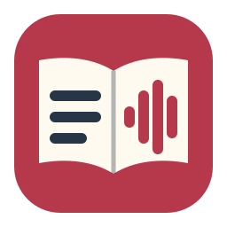

<p align="center">
  
</p>

# Cambridge Dictionary Audio

[](https://github.com/0then0/cambridge-dictionary-audio/actions/workflows/checks.yml)
[](https://github.com/0then0/cambridge-dictionary-audio/actions/workflows/mobile.yml)
[](https://github.com/0then0/cambridge-dictionary-audio/releases/latest)
[](https://pypi.org/project/cambridge-dictionary-audio/)
[](CONTRIBUTING.md#python-setup)
[](LICENSE)

[English](README.md) · [Документация](docs/README.md) · [Участие в разработке](CONTRIBUTING.md) · [Журнал изменений](CHANGELOG.md)

Сохраняйте произношение английских слов из [Cambridge Dictionary](https://dictionary.cambridge.org/)
в виде MP3 и превращайте его в учебные карточки. Найдите слово, выберите нужное
значение, прослушайте американское или британское произношение и сохраните его
в локальную коллекцию вместе с транскрипцией IPA, определением и, при желании,
русским переводом. Коллекцию можно экспортировать в Anki как готовую колоду.

В проект входят графическое приложение для Windows, macOS и Linux, программа
командной строки с терминальным интерфейсом, приложения для Android и iOS и
расширение для Chrome и Firefox.

## Возможности

- Записи US и UK с транскрипцией IPA и английским определением.
- Явный выбор значения и произношения; каждое значение хранится отдельной
  записью, а значения с одной и той же аудиозаписью используют общий MP3.
- Добавление сразу нескольких слов из вставленного списка в графическом приложении.
- Необязательный русский перевод из Cambridge или офлайн-словаря
  [WikDict](https://www.wikdict.com/), с возможностью исправить его вручную.
- Экспорт в Anki (`.apkg`) с постоянными идентификаторами: повторный экспорт
  обновляет существующие карточки, а не создаёт дубликаты.
- Склейка фраз, для которых нет отдельной записи, из записей отдельных слов (через FFmpeg).
- Резервные копии `.cda` для переноса коллекции между компьютером и телефоном.
- Интерфейс на английском, русском, испанском, немецком, французском, японском
  и португальском (Бразилия).

## Скачать

<!-- downloads:start -->
Прямое скачивание последнего проверенного стабильного релиза **v1.1.0**:

| Платформа | Архитектура | Скачать |
| --- | --- | --- |
| Windows 10+ | x86-64 | [](https://github.com/0then0/cambridge-dictionary-audio/releases/download/v1.1.0/cambridge-dictionary-audio-1.1.0-windows-x86_64-setup.exe) [](https://github.com/0then0/cambridge-dictionary-audio/releases/download/v1.1.0/cambridge-dictionary-audio-1.1.0-windows-x86_64-portable.zip) |
| macOS 14+ | Apple Silicon (arm64) | [](https://github.com/0then0/cambridge-dictionary-audio/releases/download/v1.1.0/cambridge-dictionary-audio-1.1.0-macos-arm64.pkg) [](https://github.com/0then0/cambridge-dictionary-audio/releases/download/v1.1.0/cambridge-dictionary-audio-1.1.0-macos-arm64.dmg) [](https://github.com/0then0/cambridge-dictionary-audio/releases/download/v1.1.0/cambridge-dictionary-audio-1.1.0-macos-arm64.tar.gz) |
| macOS 14+ | Intel (x86-64) | [](https://github.com/0then0/cambridge-dictionary-audio/releases/download/v1.1.0/cambridge-dictionary-audio-1.1.0-macos-x86_64.pkg) [](https://github.com/0then0/cambridge-dictionary-audio/releases/download/v1.1.0/cambridge-dictionary-audio-1.1.0-macos-x86_64.dmg) [](https://github.com/0then0/cambridge-dictionary-audio/releases/download/v1.1.0/cambridge-dictionary-audio-1.1.0-macos-x86_64.tar.gz) |
| Linux | x86-64 · glibc 2.34+ | [](https://github.com/0then0/cambridge-dictionary-audio/releases/download/v1.1.0/cambridge-dictionary-audio_1.1.0_amd64.deb) [](https://github.com/0then0/cambridge-dictionary-audio/releases/download/v1.1.0/cambridge-dictionary-audio-1.1.0-1.x86_64.rpm) [](https://github.com/0then0/cambridge-dictionary-audio/releases/download/v1.1.0/cambridge-dictionary-audio-1.1.0-linux-x86_64-portable.tar.gz) |
| Android 9+ | arm64-v8a / armeabi-v7a / x86_64 | [](https://github.com/0then0/cambridge-dictionary-audio/releases/download/v1.1.0/cambridge-audio-1.1.0-android-debug-TEST-ONLY.apk) [](https://github.com/0then0/cambridge-dictionary-audio/releases/download/v1.1.0/cambridge-audio-1.1.0-android-unsigned-NOT-INSTALLABLE.apk) |
| iOS 17+ | arm64 | [](https://github.com/0then0/cambridge-dictionary-audio/releases/download/v1.1.0/cambridge-audio-1.1.0-ios-device-unsigned-REQUIRES-SIGNING.tar.gz) [](https://github.com/0then0/cambridge-dictionary-audio/releases/download/v1.1.0/cambridge-audio-1.1.0-ios-simulator-NOT-FOR-DEVICE.tar.gz) |
| Python CLI | Любая | [](https://github.com/0then0/cambridge-dictionary-audio/releases/download/v1.1.0/cambridge_dictionary_audio-1.1.0-py3-none-any.whl) [](https://github.com/0then0/cambridge-dictionary-audio/releases/download/v1.1.0/cambridge_dictionary_audio-1.1.0.tar.gz) |
| Chrome | Любая | [](https://github.com/0then0/cambridge-dictionary-audio/releases/download/v1.1.0/cambridge-audio-chrome-1.1.0.zip) |
| Firefox | Любая | [](https://github.com/0then0/cambridge-dictionary-audio/releases/download/v1.1.0/cambridge-audio-firefox-1.1.0.zip) |

[](https://github.com/0then0/cambridge-dictionary-audio/releases/download/v1.1.0/SHA256SUMS.txt)

Android: тестовый APK подписан сертификатом разработчика; APK без подписи нужно подписать перед установкой. iOS: архив для устройства требует подписи и профиля подготовки; сборка симулятора не устанавливается на iPhone. [Установка и подпись](docs/mobile/install.md).
<!-- downloads:end -->

Установщики и переносимые сборки уже содержат Python, Qt и FFmpeg с LAME для
обработки аудио; ничего дополнительно устанавливать не нужно. Для Windows нужна
Windows 10 или новее. Установщики не подписаны сертификатом издателя, а сборки
macOS не нотарифицированы, поэтому при первом запуске система может запросить
подтверждение. В каждый релиз входят исходники FFmpeg/LAME и `SHA256SUMS.txt`.

Программа командной строки опубликована на [PyPI](https://pypi.org/project/cambridge-dictionary-audio/):

```sh
uv tool install cambridge-dictionary-audio
```

Можно также использовать `pipx install cambridge-dictionary-audio`.

## Быстрый старт

**Графическое приложение.** Введите слово или фразу и нажмите **Найти**.
Выберите значение, переключите US/UK, прослушайте запись кнопкой **Слушать**
и нажмите **Сохранить значение**. Записи сохраняются в папку
`Cambridge Dictionary Audio` внутри папки загрузок. **Список слов...** добавляет
до 100 слов за раз. Подробнее: [руководство по приложению](docs/desktop.md).

**Командная строка.**

```sh
cambridge-audio hello                          # сохранит downloads/hello.us.mp3
cambridge-audio "good morning" --accent both   # записи US и UK
cambridge-audio hello --translation russian    # с русским переводом
cambridge-audio --lang ru                      # терминальный интерфейс на русском
```

Все параметры и сочетания клавиш описаны в [руководстве по командной строке](docs/cli.md).

**Мобильные приложения и расширение браузера.** См. [Android и iOS](docs/mobile/README.md)
и [руководство по расширению](extension/README.md).

## Документация

Подробные руководства написаны на английском языке.

- [Графическое приложение](docs/desktop.md)
- [Командная строка и терминальный интерфейс](docs/cli.md)
- [Коллекция, переводы и Anki](docs/collection.md)
- [Android и iOS](docs/mobile/README.md)
- [Расширение браузера](extension/README.md)
- [Источники данных и лицензии](docs/data-sources.md)
- [Вся документация](docs/README.md)

## Запуск из исходников

Установите [uv](https://docs.astral.sh/uv/getting-started/installation/) версии
0.13.0 или новее и выполните в каталоге проекта:

```sh
uv sync --locked --group gui
uv run --locked --group gui -m cambridge_audio.gui   # графическое приложение
uv run --locked -m cambridge_audio hello             # командная строка
```

Структура проекта, тесты и сборка релизов описаны в [CONTRIBUTING.md](CONTRIBUTING.md).
Сообщения об ошибках и предложения принимаются в
[GitHub Issues](https://github.com/0then0/cambridge-dictionary-audio/issues/new/choose);
о проблемах безопасности сообщайте закрыто, как описано в [SECURITY.md](SECURITY.md).

## Лицензия

Приложение распространяется по [лицензии Apache 2.0](LICENSE). Оно основано на
[astrosander/cambridge-dictionary-audio](https://github.com/astrosander/cambridge-dictionary-audio);
код, унаследованный из этого проекта, сохраняет [лицензию MIT](LICENSE-MIT).
Атрибуция приведена в [NOTICE](NOTICE). Входящие в сборки компоненты, например
Qt/PySide6 и FFmpeg, сохраняют собственные лицензии.

Cambridge Dictionary Audio является независимым проектом и не связан с Cambridge
University Press & Assessment. Словарные материалы и записи принадлежат их
правообладателям и регулируются [условиями использования Cambridge](https://dictionary.cambridge.org/terms-of-use).
См. [источники данных и лицензии](docs/data-sources.md).
